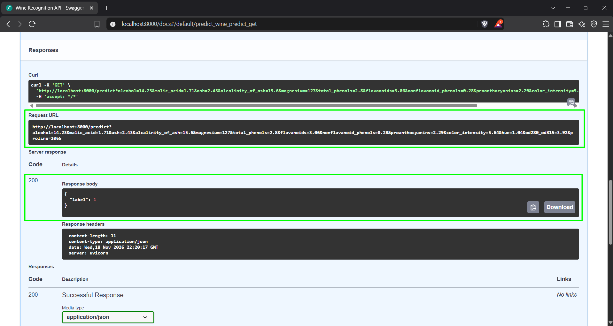
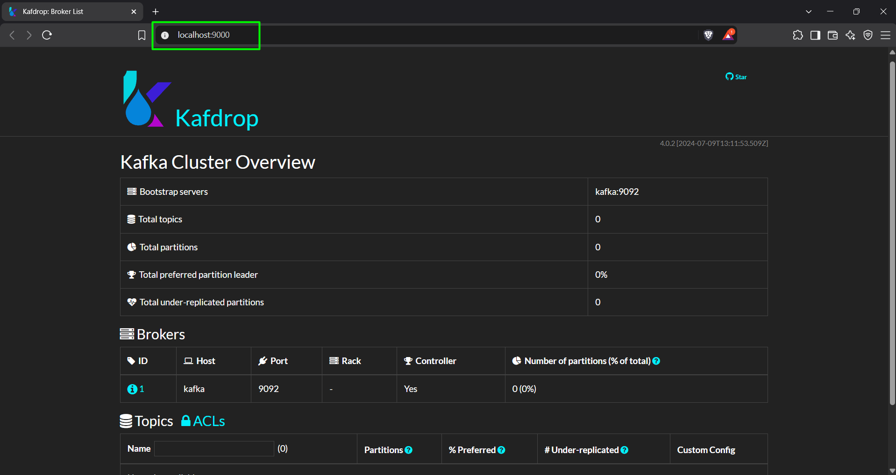
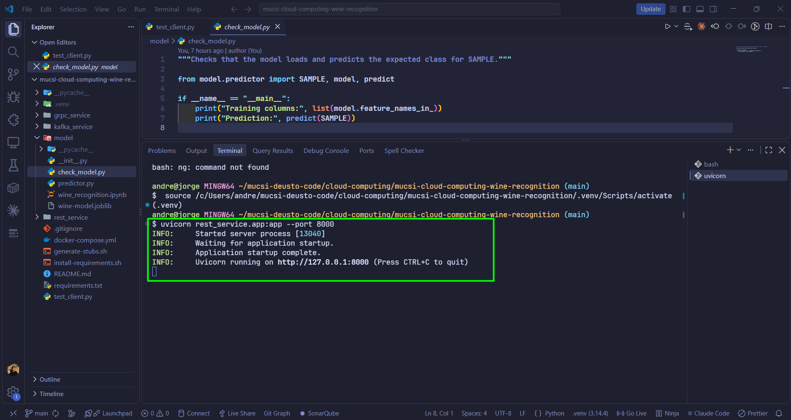
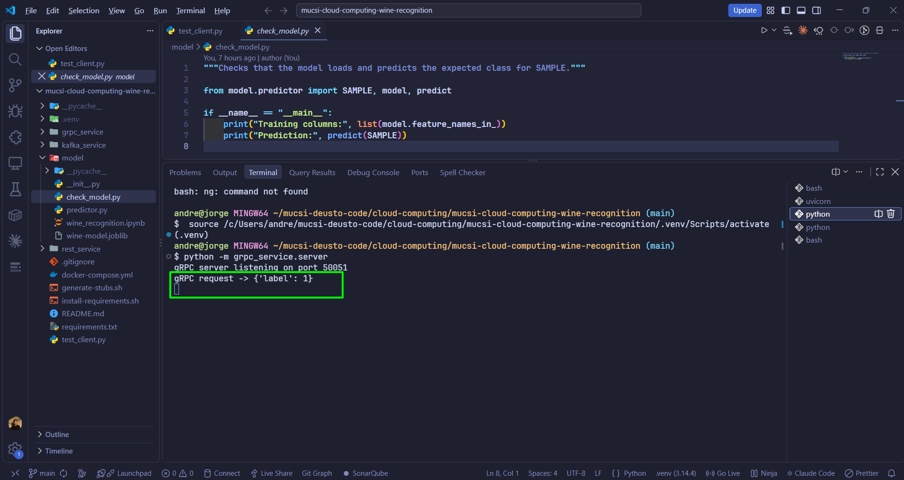
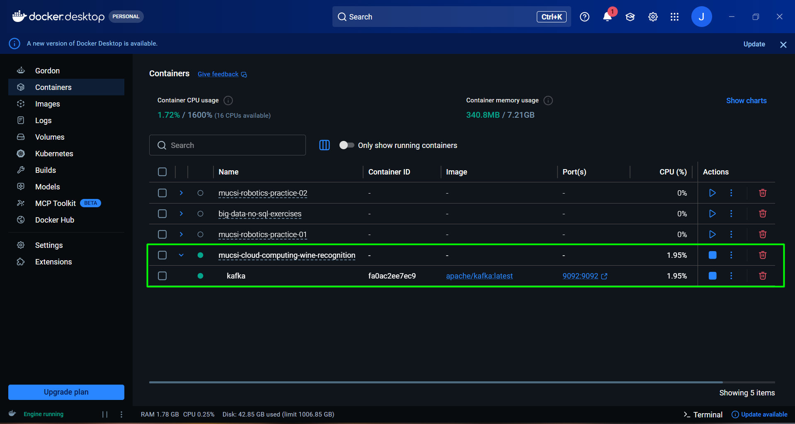

# Wine Recognition · Microservicios

**[Jorge Andrés Vargas Cordoba](https://github.com/JorgeAVargasC)** · Cloud Computing · MUCSI, Universidad de Deusto

Clasificador de vinos expuesto por **REST**, **gRPC** y **Kafka**.

| Carpeta | Contenido |
|---|---|
| `model/` | modelo, notebook y `predictor.py` (compartido por los 3 servicios) |
| `rest_service/` | FastAPI · `GET /predict` |
| `grpc_service/` | `wine.proto`, stubs y servidor |
| `kafka_service/` | worker: `wine-requests` → `wine-predictions` |
| `test_client.py` | prueba las 3 vías |

## Instalar

```bash
python -m venv .venv
source .venv/Scripts/activate
pip install -r requirements.txt
```

## Ejecutar sin Docker

| Terminal | Comando |
|---|---|
| 1 | `docker compose up -d` |
| 2 | `uvicorn rest_service.app:app --port 8000` |
| 3 | `python -m grpc_service.server` |
| 4 | `python -m kafka_service.worker` |
| 5 | `python test_client.py` |

Salida esperada: `{'label': 1}` en REST, gRPC y Kafka. Swagger: http://localhost:8000/docs

## Docker

`docker-compose.yml` levanta todo el sistema: ZooKeeper, Kafka, Kafdrop y los 3 servicios (REST, gRPC y worker), cada uno con su `Dockerfile`.

```bash
docker compose build
docker compose up -d
KAFKA_BOOTSTRAP_SERVERS=127.0.0.1:29092 python test_client.py
docker compose down
```

| Servicio | Contenedor | Puerto |
|---|---|---|
| `zookeeper` | `zookeeper` | `22181:2181` |
| `kafka` | `kafka` | `29092` (este equipo), `29093` (otros equipos); `9092` solo dentro de la red |
| `kafdrop` | `kafdrop` | `9000` · http://localhost:9000 |
| `rest` | `wine-rest` | `8000` |
| `grpc` | `wine-grpc` | `50051` |
| `kafka-worker` | `wine-kafka-worker` | ninguno |

- El modelo no está dentro de las imágenes: se monta como volumen de solo lectura en `/models` y se localiza con `MODEL_PATH`. Cambiar el modelo no requiere reconstruir.
- `.env` centraliza los puertos, los topics, el grupo del worker y `KAFKA_HOST_IP` (IP para clientes en otros equipos). Compose lo lee solo.
- Rutas de build relativas (`context: .`): funciona igual en cualquier equipo.
- Dentro de la red `wine-recognition_default` los servicios se encuentran por nombre (`kafka:9092`). Desde el equipo, el cliente usa `127.0.0.1:29092`.
- Kafka tiene `healthcheck` y el worker y Kafdrop esperan a que esté `healthy`.
- Los datos de Kafka y ZooKeeper se guardan en `Kafka/kafka-storage/` (ignorada por Git), así que sobreviven a `docker compose down`.

### Variables de entorno

| Variable | Default | Servicio |
|---|---|---|
| `REST_HOST` / `REST_PORT` | `0.0.0.0` / `8000` | REST |
| `GRPC_PORT` | `50051` | gRPC |
| `KAFKA_BOOTSTRAP_SERVERS` | `kafka:9092` en la imagen, `127.0.0.1:9092` en local | worker y cliente |
| `REQUESTS_TOPIC` / `PREDICTIONS_TOPIC` | `wine-requests` / `wine-predictions` | worker y cliente |
| `CONSUMER_GROUP` | `wine-predictor` | worker |
| `KAFKA_CONNECT_RETRIES` / `KAFKA_CONNECT_WAIT_SECONDS` | `30` / `2` | worker |
| `MODEL_PATH` | `/models/wine-model.joblib` en la imagen | los 3 servicios |
| `REST_URL` / `GRPC_TARGET` | `http://localhost:8000` / `localhost:50051` | clientes |

Sin Docker se leen del entorno del proceso. En los contenedores, el `Dockerfile` trae los valores por defecto y `docker-compose.yml` los toma de `.env`.

### Diferencias con el enunciado

- Kafka publica `29092` y `29093`, no `22181:2181`: ese puerto ya es de ZooKeeper.
- `EXTERNAL_SAME_HOST` se anuncia como `127.0.0.1:29092` y no `localhost`, que en Windows resuelve primero a IPv6 y falla.
- La IP `192.168.5.242` del ejemplo se sustituye por `KAFKA_HOST_IP`.
- Imágenes fijas: `confluentinc/cp-zookeeper:7.6.1`, `confluentinc/cp-kafka:7.6.1` y `obsidiandynamics/kafdrop:4.0.2`.

## Notas

- Stubs de gRPC: `./generate-stubs.sh` (solo si cambia `wine.proto`).
- Windows: el broker se anuncia en `127.0.0.1` (no `localhost`, que va por IPv6 y falla); `kafka-python==2.3.1` con `api_version=(3, 9)`.

## Evidencias

Las 3 vías devuelven la misma predicción:


Swagger, `GET /predict`:



## Evidencias Docker Compose

Stack de Kafka levantado (`docker compose up -d zookeeper kafka kafdrop`):


ZooKeeper, Kafka y Kafdrop en Docker Desktop:


Kafdrop con el broker:



Construcción de las imágenes (`docker compose build`):


Los 6 contenedores levantados (`docker compose up -d`):


Proyecto `wine-recognition` en Docker Desktop:


Red `wine-recognition_default`:


Prueba con `test_client.py`:


Logs de los tres servicios tras la prueba:


Kafdrop con los topics `wine-requests` y `wine-predictions`:


Swagger, `GET /predict`:


## Anexos

### A1 · Kafka levantado con Docker Compose


### A2 · Servicio REST arrancado



### A3 · Servidor gRPC arrancado


### A4 · Worker de Kafka arrancado


### A5 · Log REST de la petición


### A6 · Log gRPC de la petición



### A7 · Log del worker de Kafka


### A8 · Contenedor Kafka en Docker Desktop


