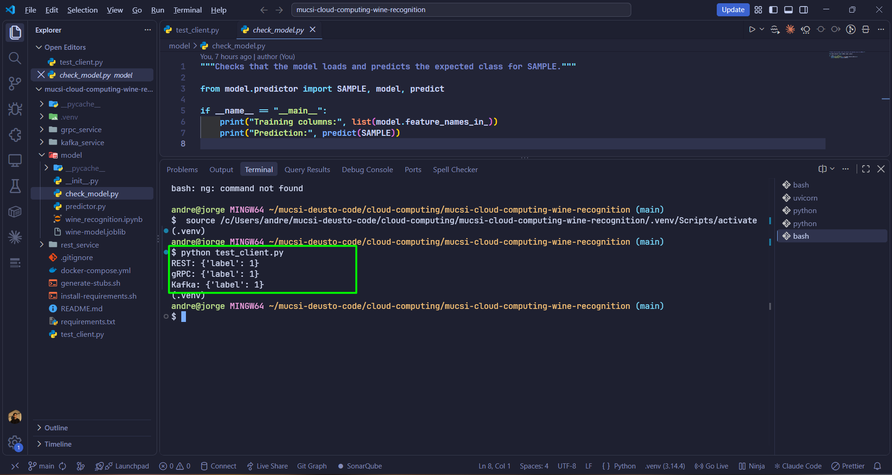
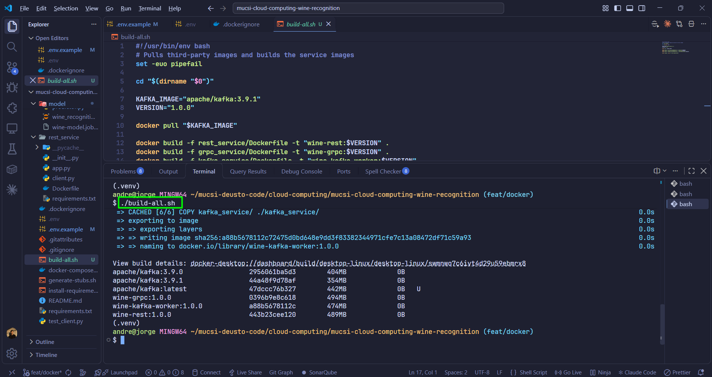
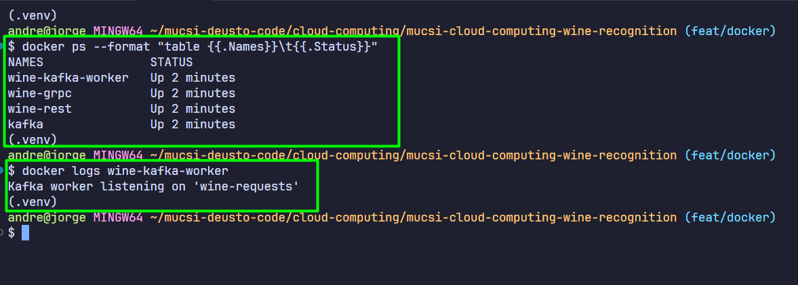
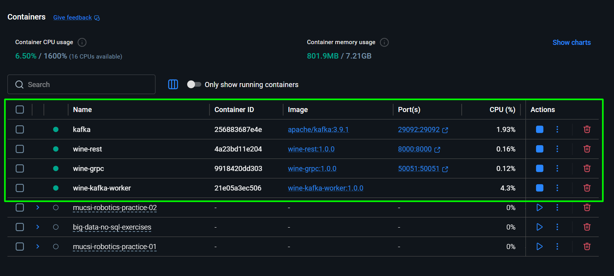

# Wine Recognition · Microservicios

**[Jorge Andrés Vargas Cordoba](https://github.com/JorgeAVargasC)** · Cloud Computing · MUCSI, Universidad de Deusto

Clasificador de vinos expuesto por **REST**, **gRPC** y **Kafka**.

| Carpeta | Contenido |
|---|---|
| `model/` | modelo, notebook y `predictor.py` (compartido por los 3 servicios) |
| `rest_service/` | FastAPI · `GET /predict` |
| `grpc_service/` | `wine.proto`, stubs y servidor |
| `kafka_service/` | worker: `wine-requests` → `wine-predictions` |
| `test_client.py` | prueba las 3 vías |

## Instalar

```bash
./install-requirements.sh
source .venv/Scripts/activate
```

## Ejecutar sin Docker

| Terminal | Comando |
|---|---|
| 1 | `docker compose up -d` |
| 2 | `uvicorn rest_service.app:app --port 8000` |
| 3 | `python -m grpc_service.server` |
| 4 | `python -m kafka_service.worker` |
| 5 | `python test_client.py` |

Salida esperada: `{'label': 1}` en REST, gRPC y Kafka. Swagger: http://localhost:8000/docs

## Docker

Cada servicio tiene su imagen (`wine-rest`, `wine-grpc`, `wine-kafka-worker`, versión `1.0.0`) y Kafka usa `apache/kafka:3.9.1`. Se construyen desde la raíz del repo.

| Script | Qué hace |
|---|---|
| `./build-all.sh` | `docker pull` de Kafka y `docker build` de las 3 imágenes propias |
| `./run-all.sh` | crea la red `wine-net` y lanza Kafka, REST, gRPC y el worker |
| `./stop-all.sh` | para los contenedores y elimina la red |

```bash
./build-all.sh
./run-all.sh
KAFKA_BOOTSTRAP_SERVERS=127.0.0.1:29092 python test_client.py
./stop-all.sh
```

- El modelo no está dentro de las imágenes: se monta como volumen de solo lectura en `/models` y se localiza con `MODEL_PATH`. Cambiar el modelo no requiere reconstruir.
- Dentro de la red, los servicios se encuentran por alias: `kafka:9092`. Desde el equipo, el cliente usa `127.0.0.1:29092`, que es el segundo listener de Kafka.
- `docker-compose.yml` es el Kafka de la entrega anterior y no se usa aquí. Ejecuta `docker compose down` antes de `run-all.sh`: ambos nombran `kafka` a su contenedor.

### Variables de entorno

| Variable | Default | Servicio |
|---|---|---|
| `REST_HOST` / `REST_PORT` | `0.0.0.0` / `8000` | REST |
| `GRPC_PORT` | `50051` | gRPC |
| `KAFKA_BOOTSTRAP_SERVERS` | `kafka:9092` en la imagen, `127.0.0.1:9092` en local | worker y cliente |
| `REQUESTS_TOPIC` / `PREDICTIONS_TOPIC` | `wine-requests` / `wine-predictions` | worker y cliente |
| `CONSUMER_GROUP` | `wine-predictor` | worker |
| `KAFKA_CONNECT_RETRIES` / `KAFKA_CONNECT_WAIT_SECONDS` | `30` / `2` | worker |
| `MODEL_PATH` | `/models/wine-model.joblib` en la imagen | los 3 servicios |
| `REST_URL` / `GRPC_TARGET` | `http://localhost:8000` / `localhost:50051` | clientes |

La lista completa está en `.env.example`.

## Notas

- Stubs de gRPC: `./generate-stubs.sh` (solo si cambia `wine.proto`).
- Windows: el broker se anuncia en `127.0.0.1` (no `localhost`, que va por IPv6 y falla); `kafka-python==2.3.1` con `api_version=(3, 9)`.

## Evidencias

Las 3 vías devuelven la misma predicción:



Swagger, `GET /predict`:


## Evidencias Docker

Construcción de las imágenes (`./build-all.sh`):



Lanzamiento de los contenedores (`./run-all.sh`):


Contenedores en ejecución y worker de Kafka escuchando:



Red `wine-net` con los 4 contenedores:


Docker Desktop:



Prueba con `test_client.py` contra los contenedores:


Logs de los tres servicios tras la prueba:


Parada de los contenedores y borrado de la red (`./stop-all.sh`):


## Anexos

### A1 · Kafka levantado con Docker Compose


### A2 · Servicio REST arrancado


### A3 · Servidor gRPC arrancado


### A4 · Worker de Kafka arrancado


### A5 · Log REST de la petición


### A6 · Log gRPC de la petición


### A7 · Log del worker de Kafka


### A8 · Contenedor Kafka en Docker Desktop


