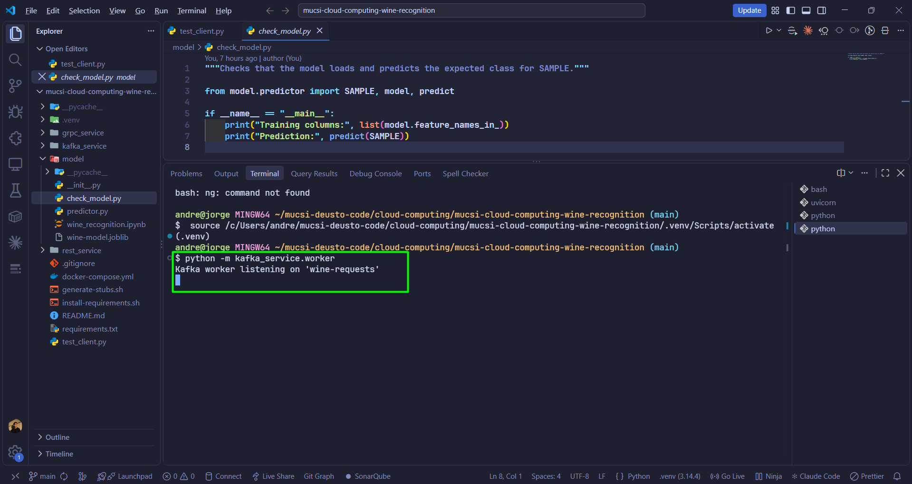

# Wine Recognition · Microservicios

Clasificador de vinos expuesto por **REST**, **gRPC** y **Kafka**.

| Carpeta | Contenido |
|---|---|
| `model/` | modelo, notebook y `predictor.py` (compartido por los 3 servicios) |
| `rest_service/` | FastAPI · `GET /predict` |
| `grpc_service/` | `wine.proto`, stubs y servidor |
| `kafka_service/` | worker: `wine-requests` → `wine-predictions` |
| `test_client.py` | prueba las 3 vías |

## Instalar

```bash
./install-requirements.sh
source .venv/Scripts/activate
```

## Ejecutar

| Terminal | Comando |
|---|---|
| 1 | `docker compose up -d` |
| 2 | `uvicorn rest_service.app:app --port 8000` |
| 3 | `python -m grpc_service.server` |
| 4 | `python -m kafka_service.worker` |
| 5 | `python test_client.py` |

Salida esperada: `{'label': 1}` en REST, gRPC y Kafka. Swagger: http://localhost:8000/docs

## Notas

- Stubs de gRPC: `./generate-stubs.sh` (solo si cambia `wine.proto`).
- Windows: el broker se anuncia en `127.0.0.1` (no `localhost`, que va por IPv6 y falla); `kafka-python==2.3.1` con `api_version=(3, 9)`.

## Evidencias

Las 3 vías devuelven la misma predicción:


Swagger, `GET /predict`:


## Anexos

### A1 · Kafka levantado con Docker Compose


### A2 · Servicio REST arrancado


### A3 · Servidor gRPC arrancado


### A4 · Worker de Kafka arrancado



### A5 · Log REST de la petición


### A6 · Log gRPC de la petición


### A7 · Log del worker de Kafka


### A8 · Contenedor Kafka en Docker Desktop


